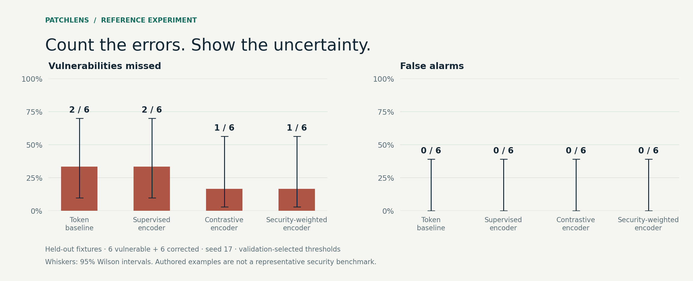
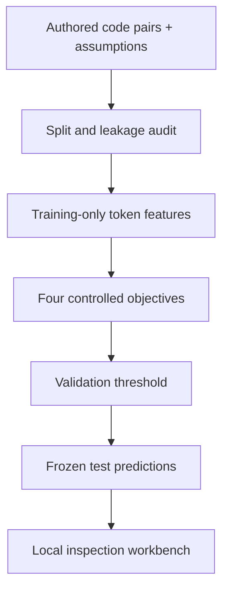
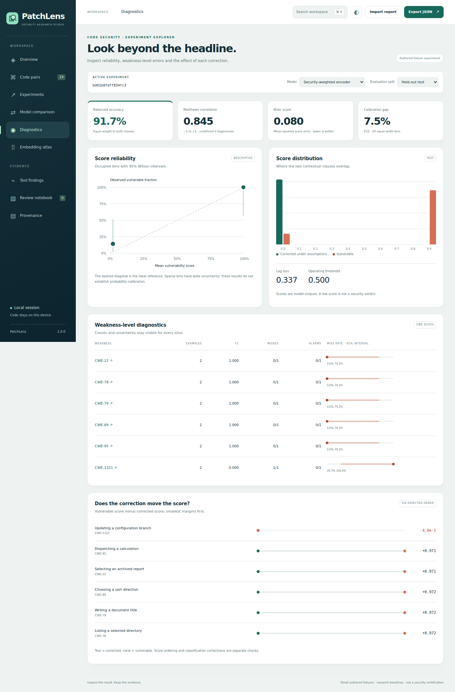

<p align="center"></p>

<p align="center">
  <strong>Code pairs. Controlled experiments. Inspectable evidence.</strong><br>
  A local security research studio for comparing models, inspecting code and keeping review evidence.
</p>

<p align="center">
  <a href="https://sarvenaz-m.github.io/PatchLens/"><strong>Open the interactive demo →</strong></a> ·
  <a href="docs/assets/workbench-overview.png">Static preview</a> ·
  <a href="docs/assets/workbench-tour.webm">Watch the full recording</a>
</p>

<p align="center">
  <a href="https://sarvenaz-m.github.io/PatchLens/">
    
  </a>
</p>

<p align="center"><sub>Actual interface recording. Open the demo to explore all nine workspaces, compare models and inspect the included results.</sub></p>

<p align="center">
  <a href="#start-in-two-minutes">Quick start</a> ·
  <a href="docs/METHODOLOGY.md">Methodology</a> ·
  <a href="docs/DATA_CARD.md">Data card</a> ·
  <a href="docs/REPRODUCIBILITY.md">Reproduce</a> ·
  <a href="docs/INTEGRATIONS.md">Integrations</a> ·
  <a href="docs/ANALYSIS.md">Diagnostics & review</a> ·
  <a href="docs/DEMO_WALKTHROUGH.md">Walkthrough</a>
</p>

---

PatchLens connects a model's security score to the exact code, correction, label assumptions and experiment that produced it. It includes a working CPU research pipeline, four controlled baselines, a curated fixture collection and a polished, dependency-free web interface.

**The bundled results are real executions on 48 authored examples.** They validate the pipeline and support inspection; they are not evidence of production vulnerability-detection performance. The included models are compact lexical and MLP baselines, not pretrained language models. Corrected examples are labelled only under their documented assumptions.

## Version 1.0.0

- A redesigned studio with a decision map, nine workspaces, command search and responsive light/dark layouts.
- Reliability diagrams, per-CWE uncertainty intervals, pair score margins, balanced accuracy and Matthews correlation.
- Paired model comparison across matching reports, with improved decisions, regressions and CSV export.
- A local review notebook with dataset-scoped notes, status filters and portable JSON backups.
- Python analysis commands with source fingerprint verification and a paired bootstrap over complete groups.
- Actual local transformer tests for frozen training, full fine-tuning, weighted contrastive LoRA, saved-adapter inference and causal generation.
- A real Semgrep scan, a findings ledger and a model/scanner disagreement queue.
- CodeQL CLI orchestration and SARIF import with explicit failed and incomplete states.
- Three-seed reference runs, browser-verified desktop/mobile layouts and a recorded UI walkthrough.

## What you can inspect

| Surface | What it shows |
|---|---|
| **Overview** | Actual training traces, ablation results, confusion counts and an error inspection queue |
| **Code pairs** | Vulnerable and corrected JavaScript, highlighted line differences, model scores and contextual assumptions |
| **Experiments** | Precision–recall and ROC curves, classification stability and an exploratory threshold control |
| **Model comparison** | Matched reports or models, improved decisions, regressions, shared errors and CSV export |
| **Diagnostics** | Reliability, score distributions, CWE slices with uncertainty intervals and correction score margins |
| **Embedding atlas** | Actual model representations projected with a PCA basis fitted on training data |
| **Tool findings** | Scanner findings linked to code pairs, reported coverage and disagreements with the selected model |
| **Review notebook** | Browser-local review status and observations, with validated import and backup export |
| **Provenance** | Split assignments, dataset fingerprints, run configuration, environment and explicit limits |

The interface supports light and dark appearance, keyboard navigation, local JSON import and report export. Press **Ctrl+K / ⌘K** to find a page or code pair. Review notes are stored separately from experiment reports; export a backup before moving to another browser or clearing browser storage. Snippets are displayed as text. The workbench does not execute code or make network requests.

## Start in two minutes

**Explore the included run:** download and extract this repository, then open **`index.html`** in a browser. The report is already bundled; no installation or server is needed. If your browser blocks local scripts, serve the folder with `python -m http.server 8000 --bind 127.0.0.1` and open `http://127.0.0.1:8000`.

**Run a new experiment:** use Python 3.10 or newer.

```bash
python -m venv .venv
# macOS / Linux:
source .venv/bin/activate
# Windows PowerShell: .venv\Scripts\Activate.ps1
python -m pip install -e .
patchlens audit
patchlens demo --output runs/my-experiment
```

Open `runs/my-experiment/workbench/index.html`. NumPy is the only core runtime dependency. Installation may need internet access; the core experiment itself needs no network, GPU, API key or external model.

Watch the [recorded browser walkthrough](docs/assets/workbench-tour.webm) or follow the [five-minute demo guide](docs/DEMO_WALKTHROUGH.md).

## A small, honest experiment

The fixture collection has **24 pairs across six weakness categories**, split by scenario into 24 training, 12 validation and 12 test examples. Original code and its corrected sibling always stay in the same split. A local parameter rename supplies a label-preserving view. Vocabulary and IDF use training data only.

| Model | Training objective | Test F1 | Missed / vulnerable | False alarms / corrected |
|---|---|---:|---:|---:|
| Token baseline | TF-IDF + logistic classification | 0.800 | 2 / 6 | 0 / 6 |
| Supervised encoder | Small MLP + binary classification | 0.800 | 2 / 6 | 0 / 6 |
| Contrastive encoder | Classification + masked paired contrastive loss | 0.909 | 1 / 6 | 0 / 6 |
| Security-weighted encoder | Contrastive objective + weighted positive-class loss | 0.909 | 1 / 6 | 0 / 6 |

Reference: seed **17**, **240** epochs, Python **3.12.14**, NumPy **2.3.5**. Each threshold is selected on validation by maximizing recall under an FPR ceiling of 0.20, then frozen for test. The ceiling is not a test-set guarantee. Raw scores, checkpoint weights and configuration are included in [`examples/fixture-run`](examples/fixture-run).

**One example changes test recall by 16.7 percentage points.** Zero false alarms among six corrected examples has a 95% Wilson interval of approximately 0–39%. The security-weighted objective ties the ordinary contrastive model here; there is no evidence from this run that weighting improves it. Report-level metrics include interval bounds.

<p></p>

## The distinction that drives the experiment

A vulnerable snippet and its security-changing correction must not be treated as interchangeable positive views. PatchLens uses the authored **label-preserving rename** as the contrastive positive. Opposite-label examples, including the correction, are negatives; other same-label examples are masked out. An explicit classification head supplies the security score.

The NumPy implementation exposes every loss term and gradient. Finite-difference tests check the complete weighted contrastive objective, including representation normalization. See the equations and limitations in [Methodology](docs/METHODOLOGY.md).



## Commands

```bash
# Inspect a dataset contract.
patchlens audit path/to/dataset.jsonl

# Train the four reference models with a fixed seed.
patchlens demo --dataset path/to/dataset.jsonl --seed 17 --epochs 240 --output runs/custom

# Reuse numeric JSON weights; no pickle deserialization.
patchlens predict --checkpoint examples/fixture-run/model-weighted.json --output runs/scores.jsonl

# Evaluate exactly matched example IDs at an explicitly supplied threshold.
patchlens evaluate --predictions runs/scores.jsonl --threshold 0.5 --split test --output runs/evaluation.json

# Regenerate the portable interface for an existing report.
patchlens export examples/fixture-run/report.json --output runs/exported-workbench
```

The `evaluate` threshold above is illustrative. To reproduce a run's operating point, use the exact value saved in its report; do not round it. Output directories that contain unrelated files are protected from experiment overwrite.

## Optional integrations

The [integration guide](docs/INTEGRATIONS.md) includes complete commands for:

- Training an encoder with frozen representations, ordinary fine-tuning or PEFT/LoRA, with optional paired contrastive and weighted-classification terms.
- Saving and reloading full classifiers or adapters, then adding actual predictions, embeddings and history to the workbench.
- Scanning with Semgrep or an independently installed CodeQL CLI; importing SARIF and attaching findings without altering labels.
- Generating code as text with a local causal model, recording prompts and settings, and summarizing independently obtained scanner findings.

**Executed here:** real Semgrep 1.137.0 scan, and real training/inference/generation tests using tiny locally initialized transformers. **Not claimed:** pretrained code-model efficacy, a real CodeQL execution, GPU validation or a public-code benchmark. Implementation tests and research evidence are different deliverables.

## Analyze and compare saved reports

```bash
# Recompute diagnostics after verifying the report's actual source fingerprint.
patchlens analyze examples/fixture-run/report.json --run weighted --split test --output runs/diagnostics.json

# Compare models on identical examples, preserving each stored validation threshold.
patchlens compare examples/fixture-run/report.json examples/fixture-run/report.json \
  --baseline-run linear --candidate-run weighted --draws 1000 --seed 17 \
  --output runs/comparison.json
```

The second report can come from another seed or an externally trained model. Its actual code, labels, groups and split assignments must match. The CLI resamples whole groups together for an exploratory 95% percentile interval on the accuracy difference. It does not treat two members of a code pair as independent. See [Analysis and review](docs/ANALYSIS.md) for assumptions and formulas. Actual generated outputs are included in [`examples/analysis`](examples/analysis).

<p></p>

## Repeat across seeds

```bash
patchlens repeat --seeds 17 29 43 --epochs 240 --output runs/repeated
```

The included [three-seed study](examples/repeated-study/summary.json) retains every report, prediction and checkpoint. Import any report into the workbench or use `patchlens export` to inspect it. The weighted model misses 1, 0 and 1 vulnerable examples and raises 0, 1 and 0 false alarms across these seeds. The ordinary contrastive model misses 1 and raises 0 false alarms in each run. These are the same twelve test examples every time, not three independent datasets; the study does not establish a general superiority claim.

## Verify

```bash
python -m unittest discover -s tests -v
node --test tests/*.test.cjs
node scripts/check-fixtures.cjs
```

The suite covers metric edge cases and score ties, finite-difference gradients, group leakage, training-only vocabulary, threshold provenance, deterministic training, saved-model round trips, report import validation, group bootstrap behavior and Python/JavaScript diagnostic agreement. Browser checks cover all nine workspaces, comparison import, CSV download, note persistence, command search and mobile layout. A GitHub Actions workflow is included; see [Reproducibility](docs/REPRODUCIBILITY.md) for the exact validation status of this release.

## Repository guide

```text
src/patchlens/          Python library, CLI and portable web assets
src/patchlens/data/     Authored, auditable JavaScript pairs
examples/fixture-run/  Actual reference report, scores and JSON checkpoints
tests/                 Independent numerical and data-contract tests
scripts/               Fixture generation, figures and validation helpers
integrations/          Optional scanner rules
docs/                  Methodology, cards, reproduction and visual assets
```

## Limits and next experiments

This is a research prototype release. The authored corpus is small, balanced and stylistically related across scenarios. Scenario separation does not establish repository-level generalization. Lexical normalization loses information, renaming is only one transformation, labels await independent review, and three training seeds on one tiny test set cannot establish an efficacy claim. Scores are uncalibrated model outputs. This software is not a security audit or a remediation guarantee.

A useful next study would add independently reviewed, appropriately licensed public patches with repository-disjoint splits, a pretrained encoder, repeated seeds, clustered uncertainty estimates and adjudicated static-tool disagreements. These are future experiments, not capabilities already demonstrated by the reference run.

## Contributing and licence

See [Contributing](CONTRIBUTING.md), [Security](SECURITY.md), [Data card](docs/DATA_CARD.md) and [Asset provenance](docs/ASSET_PROVENANCE.md). Code is MIT-licensed. The newly authored fixtures are dedicated under CC0-1.0. Do not contribute proprietary, confidential or unlicensed code.

Maintainer: **Sarvenaz Mahmoudzadeh Khameneh**.
