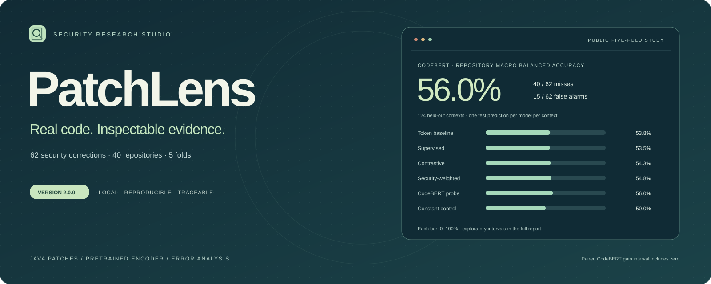
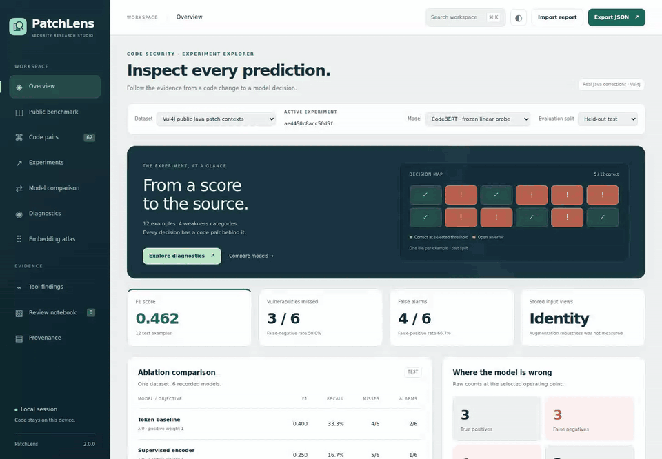
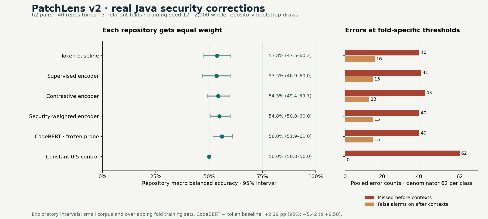
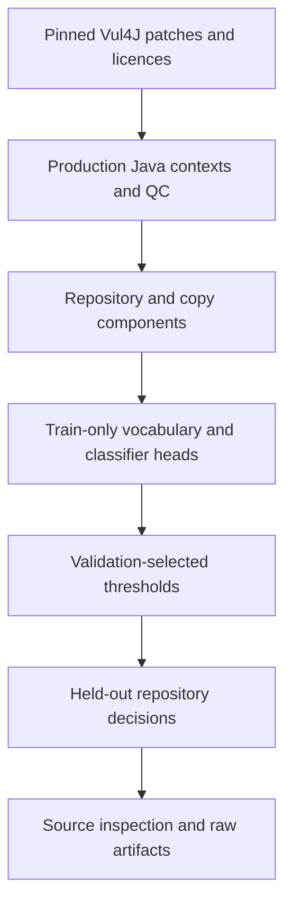

<p align="center"></p>

<p align="center"><strong>Real code. Repository splits. Inspectable evidence.</strong><br>A local studio for comparing security models and tracing each decision to its source correction.</p>

<p align="center"><a href="https://sarvenaz-m.github.io/PatchLens/"><strong>Open the interactive demo →</strong></a> · <a href="docs/assets/workbench-overview.png">Actual interface</a> · <a href="docs/assets/workbench-tour.webm">Browser walkthrough</a></p>

<p align="center"><a href="https://sarvenaz-m.github.io/PatchLens/"></a></p>

<p align="center"><a href="#start-in-two-minutes">Quick start</a> · <a href="docs/PUBLIC_BENCHMARK.md">Public study</a> · <a href="docs/DATA_CARD.md">Data card</a> · <a href="docs/MODEL_CARD.md">Models</a> · <a href="docs/REPRODUCIBILITY.md">Reproduce</a> · <a href="THIRD_PARTY_NOTICES.md">Source licences</a></p>

PatchLens connects a security score to the code, its documented correction, split assignment and experiment. Version **2.0.0** adds **62 real Vul4J security corrections from 40 repositories**, a genuine **pretrained CodeBERT** comparison, five repository-disjoint evaluation folds, source-byte verification and a workbench that exposes the failures as well as the scores.

**The experiment is deliberately scoped:** inputs are concatenated production Java patch hunks, with the surrounding Git diff context. Labels are inherited from the documented before/after correction for a particular CVE. The original upstream vulnerability tests were not re-executed here, and a corrected context can contain other flaws. This study evaluates patch-context classification rather than complete-program security.

## Version 2.0.0

- Real, attributed Java changes with original patch files, source URLs, upstream licences, notices and release-computed SHA-256 pins.
- Repository separation, shared-CVE grouping and conservative lexical/near-copy checks before model fitting.
- A 70/15/15 component reference split repeated across seeds **17, 29 and 43**.
- Five outer repository folds: train on three buckets, choose a threshold on a fourth, and test on the remaining bucket. Every one of the **124 originals** is tested once.
- Four controlled lexical/MLP baselines, a **124.6M-parameter frozen CodeBERT encoder with a train-only linear head**, and a constant-score control.
- Numeric checkpoints, saved embeddings, raw predictions, validation thresholds and repository bootstrap intervals.
- Ten offline workspaces with seven report choices: reference study, all five folds and the original authored fixtures.
- Actual CPU executions, numerical replay, browser checks and desktop/mobile captures. No API key or GPU is required.

## The result that matters

The five-fold study uses one declared training seed, **17**. All three percentage columns give each test repository component equal weight; error counts pool the 124 contexts. The intervals resample complete components using 2,000 draws. They are exploratory: the corpus is small and fold training sets overlap.

| Model | Macro balanced accuracy · 95% interval | Pair ordering | Both versions classified correctly | Misses | False alarms |
|---|---:|---:|---:|---:|---:|
| Token baseline | 53.8% (47.5–60.2%) | 62.4% | 14.1% | 40 / 62 | 16 / 62 |
| Supervised encoder | 53.5% (46.9–60.0%) | 57.1% | 14.6% | 41 / 62 | 15 / 62 |
| Contrastive encoder | 54.3% (49.4–59.7%) | 59.8% | 11.1% | 43 / 62 | 13 / 62 |
| Security-weighted encoder | 54.8% (50.8–60.0%) | 61.1% | 10.5% | 40 / 62 | 15 / 62 |
| CodeBERT · frozen linear probe | 56.0% (51.9–61.0%) | 73.2% | 12.1% | 40 / 62 | 15 / 62 |
| Constant 0.5 control | 50.0% (50.0–50.0%) | 0.0% | 0.0% | 62 / 62 | 0 / 62 |

**CodeBERT minus the token baseline: +2.29 percentage points, paired repository 95% interval −5.42 to +9.58 points.** The interval includes zero. The study does not establish comparative superiority. Ranking the before version above its sibling is easier than correctly classifying both at a validation-selected operating point; the low complete-pair success rate makes that distinction visible.

The separate reference hold-out has only six pairs from six repositories. CodeBERT achieves **41.7%** balanced accuracy there, compared with **50.0%** for the token baseline. Those results remain published in full. Repeating that split across seeds measures optimization variation on the same twelve contexts; it does not create new independent test data. The zero-initialized linear head is deterministic, so its repeated predictions are identical.

<p></p>

## Start in two minutes

**Explore:** extract the repository and open **`index.html`**. All reports are bundled; the workbench executes no snippets and makes no network requests. If local scripts are blocked, run `python -m http.server 8000 --bind 127.0.0.1` and open `http://127.0.0.1:8000`.

Use **Dataset** to select the reference experiment, a repository fold, or the authored JavaScript examples. **Public benchmark** shows the complete five-fold results and source split ledger. **Code pairs** links to the original correction. Model comparison, diagnostics, review notes, JSON/CSV export, keyboard search, light/dark appearance and training-fitted PCA remain available. Press **Ctrl+K / ⌘K** to search. Export browser-local review notes before clearing storage.

**Replay the public study without downloading the encoder:**

```bash
python -m venv .venv
# macOS / Linux: source .venv/bin/activate
# Windows PowerShell: .venv\Scripts\Activate.ps1
python -m pip install -e .
python scripts/verify_public_benchmark.py
patchlens benchmark --embedding-cache examples/public-benchmark/encoder --output runs/public-replay
patchlens cross-validate --embedding-cache examples/public-benchmark/encoder --output runs/five-fold-replay
```

Saved embeddings let you refit and verify the numeric models with NumPy alone. This replay does not perform a new encoder forward pass. For a fresh pretrained inference run, follow [Reproducibility](docs/REPRODUCIBILITY.md); the pinned encoder download is approximately **499 MB**, outside the Git repository.

## Trace a result



The frozen encoder processes code without fitting to this corpus. Its revision, tokenizer/weight hashes, pooling, token lengths and truncation counts are recorded. **32 of 124 contexts exceed the 512-token input budget**; a fixed equal head/tail rule applies, and no test example is removed because of its prediction. None of the retained pairs becomes identical after this tokenization and truncation. One real pair, **VUL4J-26**, becomes lexically identical under the original tokenizer's literal normalization; it remains in the study.

The public corpus uses **identity views**, with no invented rename or augmentation claims. Contrastive positives in the MLP comparison are identity copies; before/after siblings remain opposite-label negatives. The authored corpus retains its original label-preserving parameter renames and numerical gradient checks. See [Methodology](docs/METHODOLOGY.md).

## Verify

```bash
python -m unittest discover -s tests -v
node --test tests/*.test.cjs
node scripts/check-fixtures.cjs
python scripts/verify_public_benchmark.py
```

Optional browser validation uses Playwright 1.62.1:

```bash
npm install --no-save --package-lock=false playwright@1.62.1
npx playwright install --with-deps chromium
node scripts/browser-public.cjs
node scripts/browser-smoke.cjs
```

The release evidence distinguishes CPU encoder execution, numeric replay, core tests, optional tiny transformer tests and actual browser checks. See [Reproducibility](docs/REPRODUCIBILITY.md) and `docs/evidence/validation-v2.json` for counts and scope. GitHub workflows are supplied; their remote execution occurs after publication.

## Research and engineering skills

The project demonstrates controlled neural objectives, transfer learning, repository-aware evaluation and error analysis. Its Java security contexts complement Java/Android experience, while the Python experiments make model behavior and provenance reviewable. The browser interface connects those experiments to a practical review workflow.

## Repository guide

| Path | Contents |
|---|---|
| `src/patchlens/` | Python CLI, numerical models, public importer, pretrained encoder and fold evaluation |
| `src/patchlens/web/` | Dependency-free inspection studio |
| `datasets/vul4j/` | Real contexts, original source patches, cohort ledger and upstream licences |
| `configs/` | Declared protocols and pinned CodeBERT source files |
| `examples/public-benchmark/` | Three-seed reference split, saved embeddings and every checkpoint |
| `examples/repository-cross-validation/` | All five folds and one held-out prediction per original per model |
| `examples/fixture-run/` | Preserved version-1 authored reference experiment |
| `tests/`, `scripts/` | Numerical, source, browser and artifact verification |
| `docs/` | Study details, cards, validation evidence and actual captures |

## Scope and next experiments

Repository separation applies to classifier fitting within this study. Overlap with CodeBERT's pretraining cannot be ruled out. Patch hunks omit surrounding definitions and flow; correction labels are contextual rather than independently adjudicated local vulnerability labels. The permissive, retrievable subset and balanced pair sampling constrain generalization. Scores are uncalibrated and the validation FPR ceiling is not a guarantee on a new repository.

A next study can reconstruct complete methods/files from parent and fixed snapshots, rerun the upstream vulnerability tests, review labels independently, add forward chronological evaluation and compare fine-tuning with the frozen probe. The CodeQL orchestration remains available for the JavaScript integration path; a real CodeQL execution is still pending. Version-1 Semgrep findings belong to the authored JavaScript corpus and are kept separate from the public Java study.

## Attribution and licences

Vul4J: Bui, Scandariato and Díaz Ferreyra, *A Dataset of Reproducible Java Vulnerabilities Geared Towards the Study of Program Repair Techniques*, MSR 2022, [DOI: 10.1145/3524842.3528482](https://doi.org/10.1145/3524842.3528482). Data/metadata: CC-BY-4.0. Original code fragments and patches retain their upstream terms; see [Third-party notices](THIRD_PARTY_NOTICES.md).

CodeBERT: Feng et al., *A Pre-Trained Model for Programming and Natural Languages*, [paper](https://arxiv.org/abs/2002.08155), [official model card](https://huggingface.co/microsoft/codebert-base), [official project](https://github.com/microsoft/CodeBERT). Downloaded weights are not bundled.

PatchLens code is MIT-licensed; authored fixtures are CC0-1.0. See [Contributing](CONTRIBUTING.md) and [Security](SECURITY.md).
